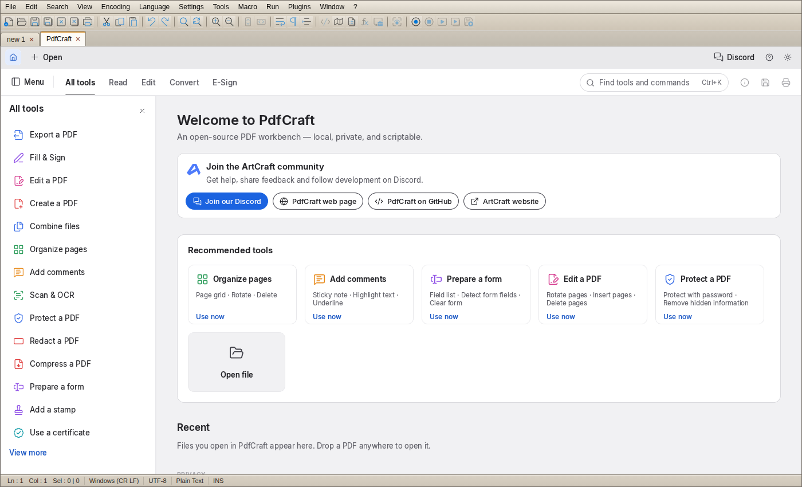

# Web app (`web/`)

This directory contains the Next.js application for glitch.txt.

## Commands

```bash
npm install
npm run dev
npm run lint
npm run build
npm run start
```

## Highlights

- Next.js App Router application
- In-browser text editing experience inspired by Notepad++
- Syntax highlighting and theme support

## PdfCraft tab

**File → Open PdfCraft Tab** opens the [PdfCraft](https://github.com/storytold/pdfcraft) PDF workbench (its WebAssembly build) in an editor tab.

The PdfCraft source is not vendored here. `npm run build` (via `prebuild`, so also on Vercel) runs `scripts/fetch-pdfcraft.mjs`, which fetches the upstream repo at a pinned ref (`PDFCRAFT_REF`, default `v0.4.0`), builds it with Rust + `trunk`, and writes the result to the git-ignored `public/pdfcraft/`. The first build takes several minutes. Locally run `npm run fetch:pdfcraft` before `npm run dev`, or set `SKIP_PDFCRAFT=1` to skip it (the menu item will then 404).


